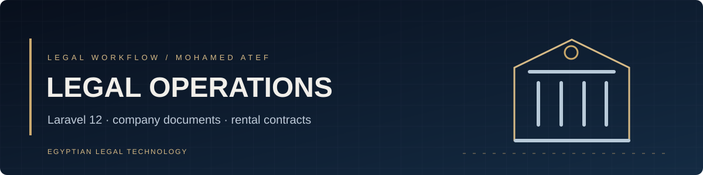
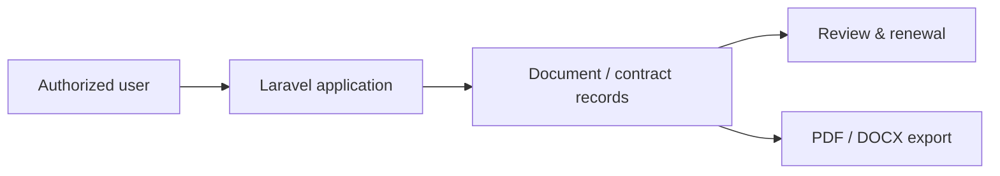

<div align="center">


# Legal Management System
**إدارة المستندات والعقود والأعمال القانونية للشركات**

[Developer profile](https://github.com/matef-hub) · [Related portfolio](https://github.com/matef-hub/atefdodo)
</div>

## Overview

A **Laravel 12** legal operations workspace with a **Vuexy** administration interface. The verified web routes include authenticated modules for company documents and rental contracts, their listings, and PDF/DOCX exports. Additional models and court-work features may be under development; their existence in the repository does not guarantee complete end-to-end workflows.

## Work areas

| Area | Repository scope |
|:--|:--|
| Company documents | Records, renewal dates, document uploads and expiry visibility |
| Rental contracts | Contract records and associated documents |
| Legal office workflows | Laravel controllers, validation, views and data models |
| Export | PDF and DOCX endpoints in the authenticated web routes |



## Development setup

Requires PHP, Composer, Node.js, a supported database, and the legally licensed Vuexy dependencies used by the project.

```bash
composer install
npm install
cp .env.example .env
php artisan key:generate
php artisan migrate
npm run build
php artisan serve
```

Configure the database **privately** before migrations. For Windows PowerShell, use `Copy-Item .env.example .env` instead of `cp`. Seeding, storage linking and production configuration depend on local project requirements.

## Data protection

**Do not use example setup commands against a production database.** This code processes potentially sensitive legal and business information. Confirm authentication, authorization, upload validation, backups and audit logging before any deployment.

A `.env` file appears in this repository's tracked root: review and rotate any real credentials and remove secrets from the full Git history before treating the repository as safe to share. Licensed commercial template assets are subject to their own terms.

Maintained by [Mohamed Atef](https://github.com/matef-hub) — Egyptian lawyer and software developer.
